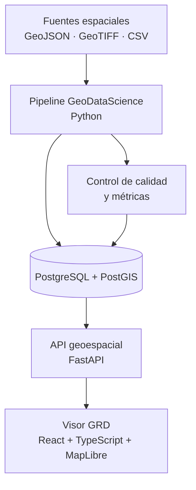

# GeoRisk Peru — Plataforma GeoDataScience para GRD

[](https://github.com/vninamore/georisk-peru-grd-platform/actions/workflows/ci.yml)
[](https://www.python.org/)
[](https://postgis.net/)
[](https://fastapi.tiangolo.com/)
[](https://react.dev/)
[](LICENSE)

Plataforma de referencia para **Gestión del Riesgo de Desastres (GRD)** que integra ingeniería geoespacial, ciencia de datos y desarrollo GIS full-stack. Permite modelar escenarios multiamenaza, calcular peligro, exposición, vulnerabilidad y riesgo, servir resultados mediante una API geoespacial y explorarlos en un visor web.

> **Portafolio técnico:** proyecto desarrollado por **Vanessa Jazmín Nina More**, bachiller en Ingeniería Geográfica, como demostración de arquitectura GIS senior y GeoDataScience aplicada a GRD.

## Problema que resuelve

Las evaluaciones de riesgo suelen estar repartidas entre archivos, hojas de cálculo y procesos manuales difíciles de reproducir. GeoRisk Peru propone un flujo trazable:

1. Ingesta y validación de datos espaciales.
2. Normalización de indicadores de peligro, exposición y vulnerabilidad.
3. Cálculo reproducible de índices y niveles de riesgo.
4. Persistencia y análisis espacial en PostGIS.
5. Publicación mediante API REST/GeoJSON.
6. Visualización y priorización territorial en un dashboard web.

## Capacidades

- Escenarios de inundación, movimientos en masa, sismo e incendios forestales.
- Motor configurable de riesgo: `R = Peligro × Exposición × Vulnerabilidad`.
- Vulnerabilidad multidimensional: física, social, económica y ambiental.
- Controles de calidad: CRS, geometrías, rangos, duplicados y completitud.
- Operaciones PostGIS: intersección, proximidad, agregación y clasificación.
- API documentada automáticamente con OpenAPI.
- Visor web con MapLibre, filtros, indicadores y detalle territorial.
- Datos sintéticos reproducibles; ninguna salida representa información oficial.
- Pruebas unitarias, linting, análisis de seguridad y CI.
- Entorno Docker Compose para desarrollo y demostración.

## Arquitectura



## Stack técnico

| Capa | Tecnologías | Responsabilidad |
|---|---|---|
| GeoDataScience | Python, NumPy, Pandas | ETL, normalización, scoring y calidad |
| API | FastAPI, Pydantic | Contratos, validación y servicios REST |
| Base espacial | PostgreSQL, PostGIS, SQL | Persistencia y geoprocesamiento |
| Frontend | React, TypeScript, MapLibre GL, Recharts | Dashboard y mapa interactivo |
| DevOps | Docker, Compose, GitHub Actions, Ruff, mypy | Entornos, CI y calidad |
| Estándares | GeoJSON, EPSG, OGC API concepts | Interoperabilidad geoespacial |

## Inicio rápido con Docker

```bash
git clone https://github.com/vninamore/georisk-peru-grd-platform.git
cd georisk-peru-grd-platform
cp .env.example .env
docker compose up --build
```

Servicios:

- Dashboard: http://localhost:3000
- API: http://localhost:8000
- OpenAPI: http://localhost:8000/docs
- PostGIS: `localhost:5432`

## Ejecución local del motor

```bash
cd backend
python -m unittest discover -s tests -v
python -m app.cli demo
uvicorn app.main:app --reload
```

Ejemplo de evaluación:

```bash
curl -X POST http://localhost:8000/api/v1/risk/evaluate \
  -H 'Content-Type: application/json' \
  -d '{
    "unit_id": "LIM-DEMO-001",
    "hazard": 0.82,
    "exposure": 0.70,
    "vulnerability": {
      "physical": 0.75,
      "social": 0.62,
      "economic": 0.55,
      "environmental": 0.40
    }
  }'
```

## Estructura

```text
backend/       API, dominio y pruebas
frontend/      dashboard cartográfico
database/      esquema, vistas y funciones PostGIS
pipeline/      ETL y control de calidad geoespacial
data/          datos sintéticos y catálogo
notebooks/     análisis reproducible
docs/          arquitectura, método y diccionario
scripts/       automatización operativa
.github/       CI, plantillas y dependencias
```

## Método

El índice compuesto se mantiene entre 0 y 1:

```text
V = 0.35·Vfísica + 0.30·Vsocial + 0.20·Veconómica + 0.15·Vambiental
E* = log(1 + exposición) / log(2)
R = peligro × E* × V
```

Los pesos, umbrales y supuestos son configurables. Consulte [Metodología](docs/methodology.md) y [Diccionario de datos](docs/data-dictionary.md).

## Calidad y ética

- Los datos incluidos son **sintéticos** y sirven únicamente para demostración.
- El modelo es una herramienta de apoyo; no reemplaza evaluación de campo ni juicio experto.
- Se documentan supuestos, linaje y limitaciones.
- Las decisiones que afecten personas deben incorporar revisión humana y fuentes oficiales.

## Roadmap

- Ingesta STAC de imágenes satelitales.
- Modelos raster de susceptibilidad y series temporales.
- Autenticación OIDC y roles institucionales.
- OGC API Features y teselas vectoriales.
- Registro de modelos, monitoreo y explicabilidad espacial.

## Documentación

- [Arquitectura](docs/architecture.md)
- [Metodología GRD](docs/methodology.md)
- [Diccionario de datos](docs/data-dictionary.md)
- [API](docs/api.md)
- [Despliegue](docs/deployment.md)
- [Contribución](CONTRIBUTING.md)

## Licencia

Código bajo licencia [MIT](LICENSE). Los datos de ejemplo son sintéticos y se publican bajo CC0.
