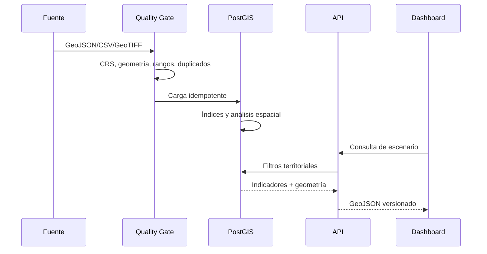

# Arquitectura técnica

## Principios

1. **Dominio independiente:** el cálculo de riesgo es una función pura y testeable.
2. **Contratos estrictos:** Pydantic y TypeScript rechazan datos fuera de rango.
3. **Spatial-first:** el SRID se declara y las geometrías poseen índices GiST.
4. **Trazabilidad:** cada evaluación registra versión, fuente, fecha y confianza.
5. **Interoperabilidad:** GeoJSON, REST/OpenAPI y PostGIS reducen acoplamiento.
6. **Security by default:** contenedores sin root, secretos fuera del código y CORS acotado.

## Componentes

### Pipeline GeoDataScience

Valida estructura, identificadores, coordenadas y completitud antes de la carga. La capa `normalize.py` estandariza indicadores, conserva la dirección semántica y permite controlar valores extremos.

Para una implementación productiva, el siguiente adaptador incorporaría GeoPandas, Rasterio, Xarray y STAC; el núcleo actual permanece liviano y puede probarse sin GDAL.

### PostGIS

El modelo separa unidades territoriales, escenarios, evaluaciones y elementos expuestos. Los índices espaciales soportan intersecciones y proximidad; las restricciones evitan índices fuera de `[0,1]`.

### API

FastAPI expone contratos versionados bajo `/api/v1`, documentación OpenAPI, validación de lotes y datos sintéticos para el dashboard. La lógica no reside en los controladores.

### Dashboard

React y TypeScript consumen GeoJSON, representan niveles ordinales y permiten filtrar por tipo de peligro. MapLibre evita dependencia de proveedores propietarios.

## Flujo de datos

## Decisiones de diseño

| Decisión | Razón | Alternativa evaluada |
|---|---|---|
| FastAPI | Contratos tipados y OpenAPI | Flask |
| PostGIS | Análisis espacial en la capa de datos | Archivos aislados |
| MapLibre | Renderizado abierto y vectorial | SDK propietario |
| Monorepo | Cambios coordinados de contratos | Repositorios separados |
| Datos sintéticos | Demo segura y reproducible | Datos operativos sensibles |

## Escalabilidad

- Particionar evaluaciones por fecha o escenario.
- Servir teselas vectoriales con `ST_AsMVT`.
- Ejecutar ETL asíncrono con colas y workers.
- Cachear catálogos y resultados inmutables.
- Publicar Cloud Optimized GeoTIFF y catálogos STAC.
- Incorporar observabilidad: métricas, trazas y logs estructurados.
